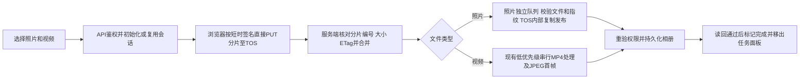

# 活动相册统一 TOS 分片上传方案

状态：方案范围已选定，待确认本文后进入实现。
日期：2026-10-31；项目：silver-community-h5。
基线：GitHub main 和服务器均为 `486d5d5c62522ac61aa2c83fb6966fca2457ada2`。
本次仅优化电脑网页活动相册及其后端；不上传小程序包，不改客户权限、分享边界或历史素材。

## 现场问题与证据

- 用户反馈今天三次尝试上传照片和视频混合的40个文件，进度长时间不动。
- 已直接读取当前 Chrome 页面：停留在「本批4/40 · 照片上传」，当前为一张JPG，只有不定进度，没有已传字节。原始文件名仅保留在本机私有诊断记录，不进入代码仓库。
- 同一相册本次 JPG 临时文件在北京时间16:11:06—16:11:37，从17,030,000增长到19,584,824字节，约80—86KB/s。照片请求已到Node，仍在接收正文，不能归因为后台转码卡死。临时文件无原文件名，仅可按相册及时间关联。
- 照片现经「浏览器→API服务器整张接收→服务器PUT至TOS→MySQL」；视频已按16MiB分片从浏览器直接传TOS。
- 真实前端函数离线复现：首张照片等待时，整批只发出1个请求，后续视频初始化0次；照片无期限、取消信号及字节进度。视频初始化、取签名、完成确认、任务轮询也未覆盖完整请求期限。
- 当前服务、磁盘、数据库健康；不能用队列为空证明浏览器选中的40个文件已到齐。

复现脚本位于任务私有目录 `frontend-audit-20261031.cjs`；取证不修改生产数据。

## 目标与边界

1. 照片和视频都分片直传TOS；API不再接收新网页照片的完整文件正文。
2. 真实显示单文件字节/速度/阶段及整批文件数，某个请求不能无限拖住整批。
3. 网络恢复或重新选择同一文件时，核对云端分片并复用已上传部分；控制请求重试不生成重复会话或重复素材。
4. 上传完成不冒充发布完成；服务器校验成功、存储和数据库读回通过后才进入相册。
5. 保留照片50MiB、视频原片2GiB、视频时长120分钟及当前MP4/首帧/完整时长检查；不把原视频直接公开。
6. JPEG/PNG/WebP/GIF照片保留现有质量和格式，不在本次静默缩图或改变GIF动画；照片压缩可另行确定参数。SVG属于矢量文档，维持既有兼容上传接口及历史可读能力，本次不迁入新的照片直传发布链路；该兼容路径同样补齐进度、期限和单条失败处理。

## 已比较的路径

| 路径 | 收益 | 代价与结论 |
| --- | --- | --- |
| 照片视频统一TOS直传、分片续传 | 移除照片的API上传大请求；统一进度、会话和恢复；符合用户本次选定范围 | 增加照片会话及发布校验分支，需完整回归；采用 |
| 只加照片进度和超时 | 变更较小，能揭示慢传和有限等待 | 仍需整张重传、仍经服务器中转；未采用 |

## 传输与发布流程

### 服务端和存储

- 复用 `project_upload_sessions` 已有 `type/ext/status/part_size/part_count` 字段，支持照片会话；不新增表或字段。视频和照片分开调度，禁止照片进入FFmpeg视频转码队列。
- 初始化、状态、分片签名、完成、停止、继续、移出任务沿用已有项目范围接口，按服务端会话类型选择验证逻辑。原视频协议及原客户端调用保持兼容。
- 浏览器只取得本账号、本相册、本会话、本分片的短期PUT签名；长期TOS密钥留在服务器。客户端不得自填最终URL、大小或指纹作为发布依据。
- 新照片原片使用专用暂存前缀，与正式 `silver-project-images` 前缀分离。分片接收完成前不登记到相册或向分享页返回暂存URL。生产只读预检确认：当前共享桶允许匿名读取，随机路径和private对象ACL不能等同于私有存储。本次保持现有桶策略，不承诺暂存对象绝对私有；严格限制获签账号、相册、键名、照片格式及安全MIME，不创建新的SVG直传发布入口。若后续要求私有暂存，另行审查专用存储或精确前缀策略，不能顺带改全桶权限。
- 分片至少5MiB，末片可小于5MiB；初始建议新照片/新视频使用8MiB，已有会话仍用各自已存的16MiB等原分片大小，绝不改变正在上传任务的分片边界。并发默认2片，保留有限重试；参数作为实现者选择需回归慢网场景。
- 初始化使用持久化的客户端随机请求标识绑定会话，并通过现有主键和单进程互斥实现幂等；重复请求须校验账号、相册、类型、文件名和大小一致，不能生成多个TOS上传任务。
- 照片校验独立串行处理，避免等待慢视频。最大临时输入50MiB，检查磁盘和取消状态；视频仍保持原有6个名额、单线程低优先级及工作空间守卫，不增加视频并发。
- 新照片直传仅接受既有JPEG/PNG/WebP/GIF。先HEAD核对实际大小，服务端流式计算SHA256并核对实际图片类型；不信任请求中的MIME/扩展名。新直传接口不接受SVG，不新建SVG可执行内容发布入口；旧SVG兼容路径及历史素材保持原有行为。
- 对照片可在传输前计算SHA256，用它查找本相册中已有的、服务端已校验的相同指纹与大小的照片，以复用已完成结果。客户端指纹只能用于查找已存在的可信素材，不能自证新文件可发布；未匹配的新照片仍需完整服务端校验。不得为视频一次性把2GiB文件读入浏览器内存来查重。
- 正式照片通过TOS服务端复制到受控发布键，不再经服务器下载后再次整张PUT。处理所需读取优先使用已验证可用的内网TOS端点；浏览器签名继续使用公网端点。内网不可用时不静默改变共享TOS配置。
- 照片发布前、提交时重新检查上传者和当前相册权限；提交时再次按可信指纹查重，避免并发完成造成重复。输出对象与数据库读回后再标记completed。
- 只清理本会话已确认发布且无引用的暂存对象；不删除旧照片、旧视频或正在上传的对象。停止/移出任务继续保留原文件及已到达的分片。
- 保留旧的整张照片上传接口作为已有客户端兼容路径；新网页的照片不走该路径。

### 前端与恢复

- 选择文件后先建立本批40项状态清单，区分待传、上传中、校验/后台处理中、已入相册、重复合并、失败/停止；不把40个输入等同于40个新增唯一素材。
- 每个分片用可取消且可报告 `upload.onprogress` 的传输。显示本片及整文件累计字节、速度、重试次数；重试时正确扣除未被确认的临时进度。
- 超时依据「持续没有传输进展」与独立绝对上限判断。不能沿用单纯180秒总时长而误杀持续慢速但正常传输的分片；控制请求及JSON响应消费也有明确期限。
- 取签名和状态等读请求有限重试；PUT同一会话同一分片可安全重试。初始化/合并等写请求先凭幂等标识或查询状态消除结果歧义，再决定重试。
- 上传100%后立即显示「等待合并/后台接收」；确认queued不冒充已进入相册。照片校验与视频转换分开显示阶段。
- 照片上传也可停止、继续、跳过本条；当前文件失败后保留续传记录并继续下一条，最后给出可重试清单。
- 本地保留会话和本批清单，不在刚进入queued时丢弃续办依据；刷新或关闭浏览器后，尚未传到TOS的部分需要重新选择同一原文件。已完整上传的文件继续在服务器后台处理。
- 已成功文件及时刷新数量与网格；任务轮询有期限，并在finally继续安排，单次请求异常不能永久停掉轮询。超过50项时显示总数和可展开/分页清单，避免FIFO中的实际处理项被最新50条隐藏。

## 验证与上线

- 先写能复现本次问题的测试：混合40项中照片挂起、慢网仍持续进度、初始化/取签名/合并响应丢失、刷新后续传、停止后立即继续、照片重复与并发完成、角色撤销。
- 验证照片50MiB和视频2GiB边界、完整分片及ETag校验、跨账号/跨相册拒绝、错误类型/不完整对象不能发布、原素材和分享下载边界不变。
- 浏览器验收真实进度、单条控制和40项状态；真实FFmpeg媒体测试、账号权限、并发、现有小程序和SSO回归通过。
- 依照GitHub分支/PR/CI/main确切SHA→服务器/TOS/CDN备份→无活动上传时受控发布→公网字节哈希和实际媒体读回执行。已有「测试通过同步服务器」授权仍只覆盖网页及后端，不上传小程序包。
- 当前40项仍在上传时不刷新用户页面，不停止服务，也不抢占或清理该批任务。发布前除SQL任务外，还必须检查旧照片接口的实际临时文件/活动请求；旧照片没有会话行，不能仅凭SQL队列为空判定空闲。若不能取得空闲发布窗口，明确保留已测试代码，另行安排部署，不能宣称已上线。
- 本批10分钟复核继续只读，区分浏览器所选、服务器收到、后台处理、最终可读四个层次；缺少原始批次清单时不宣称40项全部齐全。

## 验收标准

混合40项中任意照片慢传、断网或响应丢失，都有真实可见的阶段和有限等待；后续文件可继续。重新选择同一批不重复传完已确认分片，不因重复初始化/合并而增加重复素材；服务端权限、视频规格、服务器资源及原有公开相册下载均保持正确。

## 官方依据

- [TOS分片大小和断点续传能力](https://docs.volcengine.com/docs/torch-object-storage/overview-android-sdk?lang=zh)：非末片至少5MiB，最多10000片。
- [多端直传TOS的预签名架构](https://developer.open-douyin.com/docs/resource/zh-CN/developer/tools/cloud/best-practices/tos-multi-scene)：Web端可用服务端预签名URL直接上传。

分片参数为本方案的实现建议；官方文档证明能力与约束，不构成对本次网络速度的保证。
